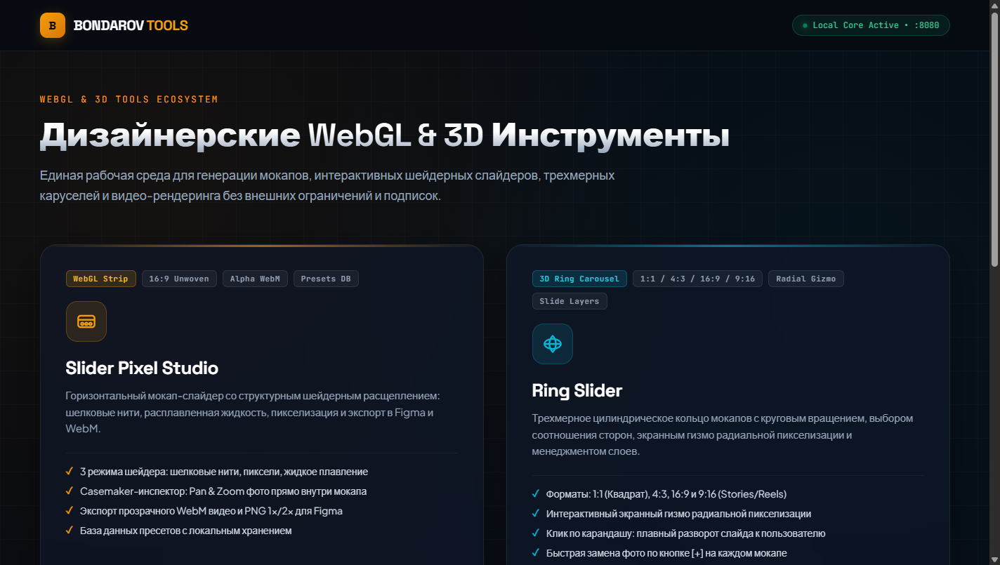
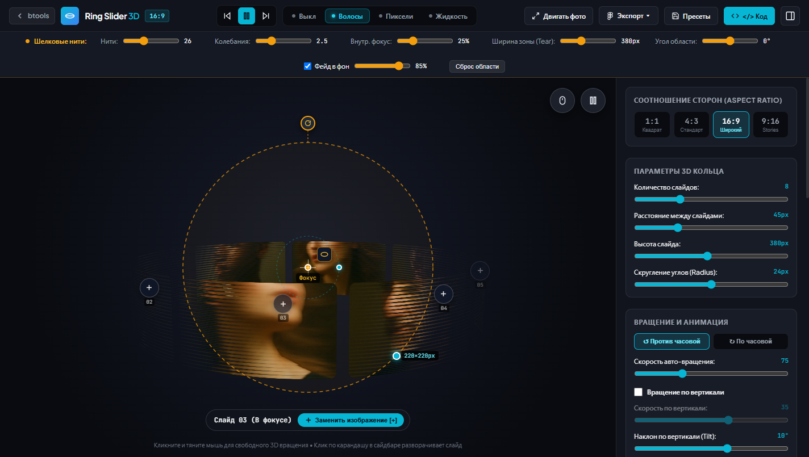
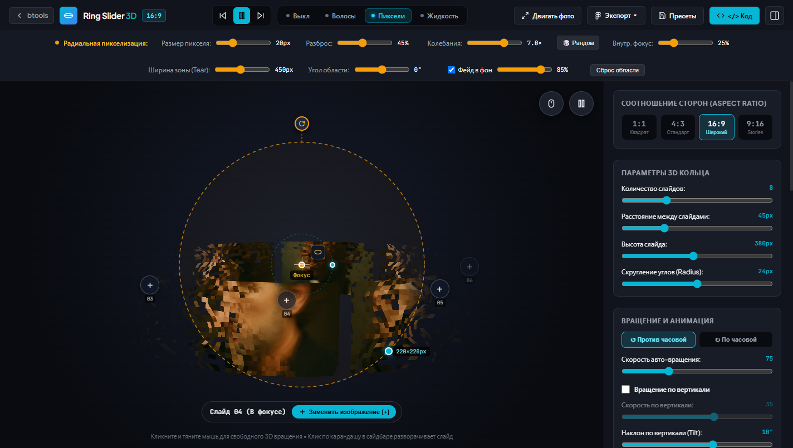
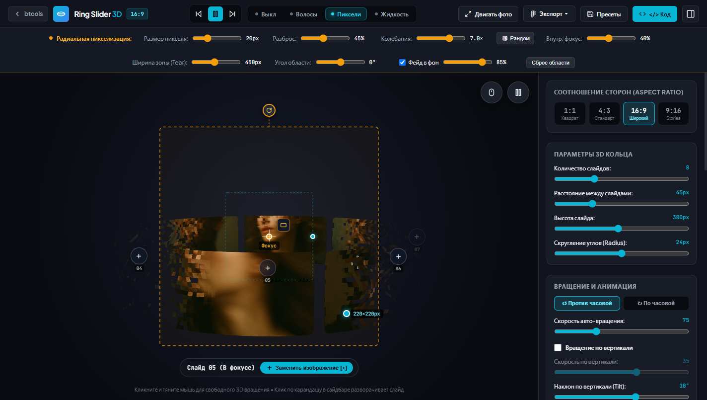
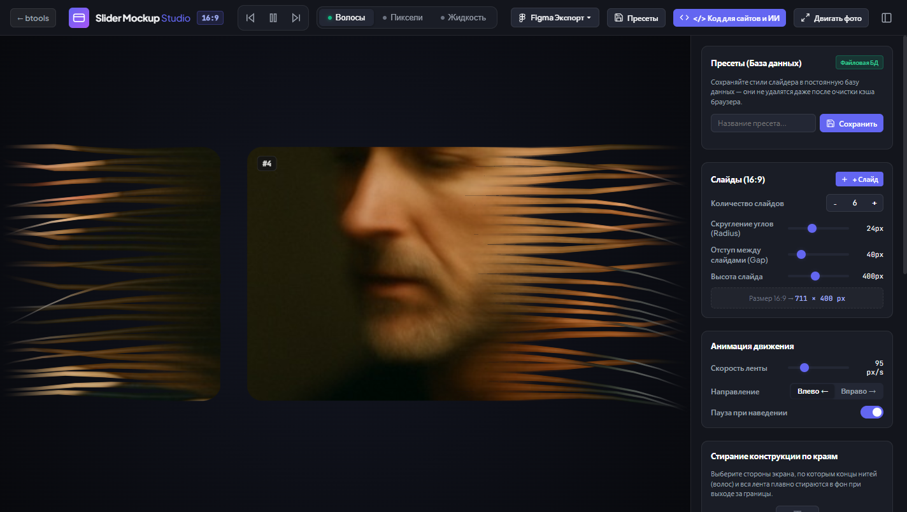

# 🎨 btools — Дизайнерская WebGL & 3D Экосистема

**btools** — набор высокопроизводительных интерактивных инструментов WebGL/Three.js для создания мокапов, презентаций и 3D-слайдеров с физическими шейдерными эффектами.



---

## 🚀 Инструменты в составе

### 1. 🪐 Ring 3D Slider Studio (`/ring-slider/`)
3D-кольцевой слайдер на изогнутых цилиндрических слайдах с интерактивным управлением камерой, кинематическим вращением и радиальными шейдерными эффектами.

- **4 формы зоны эффекта:** Овал, Круг (1:1), Прямоугольник, Квадрат (1:1).
- **Ресайз безопасного ядра фокуса:** интерактивная настройка радиуса нетронутого центра.
- **Шейдерные режимы:**
  - **Волосы / Нити (Threads Dissolve)** с чистым уводом в фон без белых линий.
  - **Пикселизация (Liquid Glass Pixel)** с динамическими волновыми колебаниями (шкала до 10.0).
  - **Жидкость (Liquid Melt)** с перетеканием хроматических каналов.
- **Инспектор слайдов (Casemaker HUD):** индивидуальное зумирование, панорамирование (Pan & Zoom) и переключение Fill/Fit для длинных скриншотов лендингов.
- **Экспорт:** готовый самодостаточный HTML/JS/WebGL код и рендер WebM видео с прозрачностью.





---

### 2. 🎞️ Slider Mockup Studio (`/slider/`)
Инструмент для демонстрации кейсов в классической 16:9 раскладке с физическим разрывом нитей и пиксельным растворением.



---

## 🛠️ Быстрый старт

### Требования
- Node.js 18+ (для запуска локального сервера и сохранения пресетов).

### Установка и запуск
```bash
# Клонирование репозитория
git clone https://github.com/Evgeny-Bondarov/btools.git
cd btools

# Запуск сервера
npm start
```

Откройте в браузере: `http://localhost:8080/`

---

## 📖 Документация

- [Инструкции для ИИ-агентов (AGENTS.md)](AGENTS.md) — регламент версионирования до десятых (`1.X`), обязательные скриншоты и правила коммитов.
- [Инструкция по развертыванию на VPS / Хостинге (DEPLOYMENT.md)](DEPLOYMENT.md) — Node.js, PM2, Nginx с SSL, Docker.
- [Журнал обновлений (CHANGELOG.md)](CHANGELOG.md) — история всех версий.

---

## 📄 Лицензия
MIT License © 2026 Evgeny Bondarov
